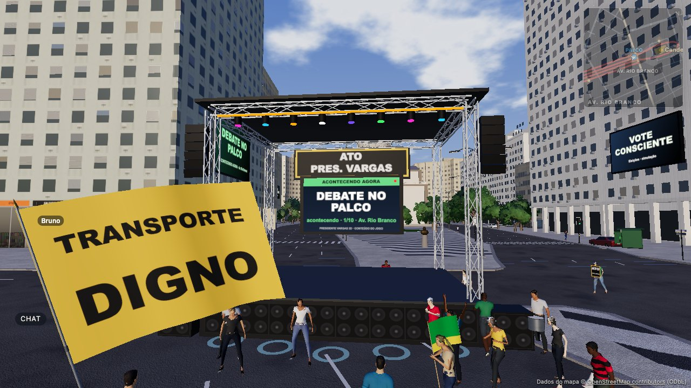

# Espaços de telão e painel — AdSlots (rodada 9, fundação)

Fundação para, no futuro, ceder espaço nos telões e painéis do mundo. **Nesta rodada não há venda**: nenhuma cobrança,
nenhum upload, nenhuma URL externa, nenhum vídeo. O servidor escolhe só conteúdo **interno** do jogo.

## Módulos

| Arquivo | O quê |
|---|---|
| `src/ads/types.ts` | contrato: `AdSlotDefinition`, `AdFormat` (IMAGE/VIDEO/CAMPAIGN/EVENT/SYSTEM), `AdContent` (EVENT ganhou um instantâneo opcional do item da agenda — aditivo) |
| `src/ads/content.ts` | puro: `validAdContent`, `internalAssetPath`, `slotPool`, `pickAd` |
| `server/src/ads/AdSlotService.ts` | servidor: carrega `public/gameplay/adslots.json`, escolhe e avisa só o que mudou |
| `src/ads/AdSlotClient.ts` | cliente: `ads` → slide do telão (`screenFeed`) ou texto do painel (`Billboards.setPanelContent`) |
| `src/world/eventScenery.ts` | `setScreenAd(alvo, slide)`: telão com slot ganha um canal próprio |
| `src/events/screenFeed.ts` | slides novos `system` (aviso/dica) e `event` (item da agenda, contagem ao vivo no relógio comum) |
| `tests/adSlots.test.ts` | rodízio, só interno, URL externa recusada, superfícies reais, conversão no cliente |

## Slots (`public/gameplay/adslots.json`)

| Slot | Superfície | Alvo real | Zona |
|---|---|---|---|
| `CENTRAL_SCREEN_01` | telão | `screen0` (treliça perto da Central) | Campo de Santana |
| `CENTRO_SCREEN_01` | telão | `screen1` | Centro |
| `STAGE_SCREEN_01` | telão | `stage0` (palco do debate) | Av. Rio Branco |
| `TRIO_SIDE_01` | telão | `trio0` (telão do trio elétrico) | anda com o trio |
| `CANDELARIA_SCREEN_01` | painel de LED | `bb_6434972_1` (não há telão de treliça na Candelária: é o painel de fachada maior da zona) | Candelária |
| `CANDELARIA_LED_01`, `RIO_BRANCO_LED_01/02`, `CENTRO_LED_01/02` | painéis de LED | `BillboardSlot.id` do manifest | por zona |

`formats` declara o que o slot aceitará no futuro; `INTERNAL_FORMATS` (SYSTEM, EVENT, CAMPAIGN) é o que esta rodada
serve. `rotateSeconds` por slot. `notices` (avisos) e `tips` (dicas de jogo/missão) são textos neutros nos dados.

## Escolha (servidor)

`slotPool(slot)`: eventos da agenda (não encerrados; os da zona do slot primeiro; até 3) **intercalados** com avisos,
dicas e designs (CAMPAIGN). Designs = campanhas cadastradas em `public/designs/campaigns.json` (todas, ordem fixa por
id — cada uma aparece o mesmo número de vezes) + arte neutra/do evento com alvo `screen`. `pickAd`: índice =
`⌊agora / rotateSeconds⌋ + índice do slot` (painéis vizinhos diferem). Verificação a 1 Hz; `ads {slots:[{id, c}]}` só
com os slots que trocaram (o EVENT muda também quando muda o estado/contagem); quem entra recebe `{slots, full: true}`.
Qualquer conteúdo fora da regra vira `null` (e conta em `stats.rejected`).

Fonte da agenda: hoje `DebateHost.agenda()` (o debate); com o agendador ligado, a agenda dele.

## Validação (cliente e servidor)

- `IMAGE` só com arte do próprio jogo: caminho relativo em `designs/ ui/ events/ landmarks/`, `.png/.webp/.jpg`, sem
  `..`, sem esquema (`http:`, `data:`, `javascript:`), sem `//host`. Nesta rodada o servidor nem gera IMAGE.
- `VIDEO`: sempre recusado. Texto: ≤ 80 caracteres, sem `<>{}`, controles ou bidi.
- O cliente revalida antes de desenhar: conteúdo inválido limpa a superfície.

## Desenho

- Telão: ao receber o primeiro conteúdo, o telão-alvo ganha um `ScreenFeed` próprio (mesmo tamanho, mesmo controle
  perto/longe e 2 Hz só perto) cuja programação é a do evento **intercalada 1:1** com o slide do slot. Os outros telões
  continuam no canal comum. Slide `event`: "ACONTECENDO AGORA / DEBATE NO PALCO / acontecendo · 1/10 · Av. Rio Branco"
  (contagem regressiva para os agendados). Slide `system`: faixa "AVISO", título e linha de apoio.
- Painel de LED: textura de texto estática (`setPanelContent`), cores por tipo (evento acontecendo em verde, agenda em
  azul, aviso em amarelo). CAMPAIGN não vai para painel de fachada nesta rodada.

## Futuro (não implementado)

Cadastro de anunciante, revisão humana do criativo, agenda de exibição, relatórios e cobrança — tudo fora desta rodada.
Antes disso: política de conteúdo, aprovação manual e os mesmos limites de neutralidade (campanhas tratadas igualmente).
