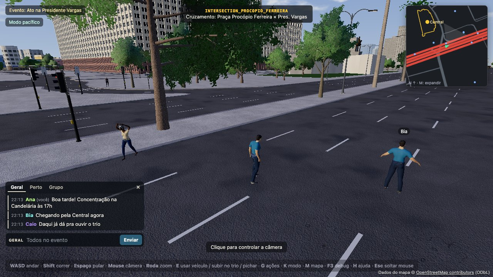

# Chat (rodada 8)

Três canais: **GERAL** (todo o evento), **PROXIMIDADE** (quem está perto) e **GRUPO** (o seu grupo do evento).
O **servidor** decide quem recebe; o cliente só diz o canal e o texto. Capturas: `docs/screenshots/round8/K_chat_geral.jpg`,
`L_chat_proximidade.jpg`, `M_chat_grupo.jpg`.

## Módulos

| Arquivo | O quê |
|---|---|
| `src/chat/protocol.ts` | contrato: canais, `CHAT_RULES`, `floodCheck`, `ChatMessage`/`ChatSend`/`ChatReport`, `REPORT_CATEGORIES` |
| `src/moderation/text.ts` | moderação de texto CENTRAL (contexto `chat`) — nenhuma outra lista de palavras |
| `server/src/chat/ChatService.ts` | autoridade: permissão, texto, anti-flood, destinatários, histórico, mutar, denúncias (sem Colyseus: testável) |
| `server/src/PresidenteVargasRoom.ts` | ganchos: `chat_send`/`chat_mute`/`chat_report`, `join`/`leave` de TODAS as conexões, `near()` pela grade `this.grid` |
| `src/ui/ChatPanel.ts` + `chat.css` | painel (desktop) e folha inferior + botão CHAT (toque) |
| `tests/chatService.test.ts`, `tools/qa/chat_mp.mjs` | testes unitários e QA multiplayer (3 navegadores + espectador) |

## Mensagens

| Direção | Tipo | Conteúdo |
|---|---|---|
| C → S | `chat_send` | `{ ch: 'geral'\|'proximidade'\|'grupo', text }` |
| C → S | `chat_mute` | `{ msg \| nid \| ref, on }` — exatamente um alvo; qualquer `userId` enviado é ignorado |
| C → S | `chat_report` | `{ id, category, details? }` |
| S → C | `chat_hello` | `{ canWrite, why?: 'visitante'\|'suspenso'\|'sem_licenca', canReport, nick, group, radius, history: ChatMessage[] }` |
| S → C | `chat` | `ChatMessage { id, ch, nick, nid, group?, text, t }` — sem userId, sessionId ou clientId |
| S → C | `chat_denied` | `{ reason: ChatRejection, retryMs }` |
| S → C | `chat_mutes` | `{ list: { ref, nick, since }[], hide?: id[] }` — ao entrar e após cada mudança (todas as conexões da conta) |
| S → C | `chat_mute_denied` | `{ reason: 'alvo_invalido'\|'proprio'\|'limite' }` |
| S → C | `chat_report_res` | `{ ok, id, r?: 'repetida'\|'limite'\|'inexistente'\|'propria'\|'sem_permissao'\|'erro' }` |

**Tamanho medido** (QA, msgpack no fio): mensagem GERAL de 44 caracteres = **103 B**; o envelope é ≈ 60 B + texto UTF-8
(máx. 200 caracteres → ≲ 470 B). GERAL é codificado **uma vez** (`room.broadcast` com `except` dos que mutaram).
Custo no servidor (teste unitário, 600 conexões): GERAL + PROXIMIDADE juntos bem abaixo de 5 ms; nada roda por tick.

## Regras (servidor)

Ordem: capacidade `chat.write` (política central — espectador, visitante, REGISTERED sem licença e suspenso **não
escrevem**) → canal válido · GRUPO exige `groupKey` (`sem_grupo`) · PROXIMIDADE exige corpo no mundo → cooldown
vigente → caracteres inválidos (bidi/invisíveis, "zalgo") → `textModeration.check(texto, 'chat')` (vazio, longo > 200,
palavrão/ódio/spam; **texto bloqueado também gera cooldown**) → `floodCheck` (5 mensagens / 8 s; repetida em 30 s;
cooldown adaptativo 2 s → dobra por infração → teto 120 s) → teto global do GERAL (8 mensagens/s na sala).

Anti-flood por **conta** (`u:userId`: reconectar não zera) ou por **conexão** (jogador anônimo de teste).

Destinatários:

| Canal | Quem recebe | Como |
|---|---|---|
| GERAL | todas as conexões do evento (jogadores **e espectadores**) | `broadcast`, exceto quem mutou o autor |
| PROXIMIDADE | jogadores a ≤ `CHAT_RULES.proximityRadius` (30 m) da posição **autoritativa** do autor no envio, e o autor | `SpatialGrid.forEachInRadius` (só as células próximas; sem laço global) |
| GRUPO | conexões com o mesmo `identity.groupKey` (EventMembership; jogador de teste: `testGroup` só com `PV_TEST=1`) | índice `groupKey → conexões` |

Decisão: **espectadores não recebem PROXIMIDADE** (não têm corpo; ler conversa "de perto" sem estar lá seria
vigilância). Espectador com conta e grupo lê o GRUPO; visitante só o GERAL. Quem entra recebe as últimas 30 do GERAL.

## Moderação pessoal e denúncias

- **Mutar** (rodada 8.1) é por **identidade**, nunca por apelido. O cliente aponta o alvo por `msg` (id de mensagem
  que ELE recebeu, ainda na cópia de 15 min), `nid` (entidade no mundo — `ChatPanel.muteEntity`) ou `ref` (item da
  própria lista); o servidor resolve para a conta (`userId`) e nunca aceita userId do cliente. Recusas: a si mesmo
  (`proprio`), alvo inexistente/não recebido (`alvo_invalido`), mais de `CHAT_MUTE_MAX` (500) ou 30 mudanças/min
  (`limite`). Filtro no servidor em GERAL, PROXIMIDADE, GRUPO e no histórico do `chat_hello` (que só sai depois de
  carregar a lista). Trocar de apelido não escapa. Mute ≠ ban: o mutado continua falando para os outros.
- Persistência: com conta, `MuteRelationship(ownerUserId, mutedUserId, mutedNicknameAtTime)` (par único, cascata ao
  apagar qualquer das contas), carregada na entrada e compartilhada pelas conexões da mesma conta. Sem conta
  (visitante, jogador anônimo de teste): vale só para a conexão (decisão: não recusar — o visitante também lê o
  GERAL); alvo sem conta é mutado por conexão. Nada em `localStorage`; `preferences.chatMuted` antigo é ignorado
  (migrado pela migration `hardening_identity_cleanup`).
- `ref` = HMAC-SHA256(`PV_SESSION_SECRET`, dono|alvo) truncado (16 chars base64url): estável para o par, inútil para
  outro dono, não revela ids. A lista mostra o apelido do momento do mute (pode estar desatualizado).
- Painel: "Mutar <apelido>" no menu da mensagem; botão **Mutados (n)** no cabeçalho lista e desmuta pelo `ref`.
- **Ocultar**: só local (remove a linha).
- **Denunciar** (categoria `REPORT_CATEGORIES`): exige `report.create` (visitante não denuncia). O servidor guarda uma
  cópia de cada mensagem por 15 min (máx. 2000) — a evidência é **essa cópia** (texto, canal, hora, apelido, userId do
  autor, grupo, nº de destinatários, até 3 mensagens anteriores do autor), nunca o que o cliente diz. Grava `Report`
  `{ targetType: CHAT_MESSAGE, targetRef: chat:<evento>:<id>, reporterUserId, targetUserId, category, details }`.
  Recusas: própria, repetida, não recebida (PROXIMIDADE/GRUPO), expirada, e **6 denúncias por 10 min** por denunciante.
  Consulta: `dev:reports` (agente A) ou `store.reports.list()`.

## Painel (cliente)

- Desktop: canto inferior esquerdo. Estados: **min** (pílula "Chat" com contador), **idle** (últimas linhas, esmaecem
  em 14 s; não captura cliques) e **open**. **Enter** abre/envia, **Esc** fecha, **Tab** troca o canal. Abas Geral / Perto /
  Grupo filtram a lista e escolhem o canal de envio (contador de não lidas por aba). Linha: hora, apelido (cor por
  hash), texto, "⋯" → Mutar / Ocultar / Denunciar… (categorias).
- Digitando, nenhuma tecla chega ao jogo: `stopPropagation` no campo, `InputManager` ignora eventos de `<input>` e
  `releaseAll()` solta W segurado. Ao abrir, o pointer lock é liberado.
- Toque: botão **CHAT** (`panel.button`) abre uma folha inferior; menu em duas colunas.
- Quem não escreve vê o GERAL com o aviso "Crie uma conta para conversar" (ou suspenso / sem licença).
- Só DOM por evento (mensagem, tecla, clique); máx. 200 linhas.

**Montagem** (o HUD é do agente E): `mountChat(hud, net, { isTouch, input, onToggle })` — hoje chamado em
`Game.connectMultiplayer`. Para outro layout: `const p = new ChatPanel(o); p.attach(net); p.mount(painelPai, paiDoBotao)`
ou posicionar `p.el` / `p.button` à mão (classes `.chat`, `.chat-btn`). QA: `window.__pv.chat()`.

## Testes

`npx vitest run tests/chatService.test.ts` (flood/cooldown/repetida, moderação, caracteres, proximidade pela grade,
isolamento de grupo, espectador/suspenso não escrevem, mutar + persistência, denúncia com evidência e limites, custo).
`node tools/qa/chat_mp.mjs http://localhost:5193` (vite rodando; sobe servidor PV_TEST próprio na 2730): 24 verificações.
`tests/chatMuteServer.test.ts`: sala real no mesmo processo com contas reais (troca de apelido, logout/login, ref/userId
forjados, desmutar); `npm run test:db`: persistência após reinício, par único, cascata.

## Reuso pelo palco de debate (rodada 9)

As falas do debate (`docs/DEBATES.md`) passam pelo **mesmo** pipeline — não há filtro paralelo:
`ChatService.screen(sid, texto, 'debate.speak')` = capacidade do canal → cooldown vigente → caracteres inválidos →
`textModeration.check(texto, 'chat')` → `floodCheck`, com penalidade adaptativa para texto bloqueado. O estado
anti-flood é o **mesmo por autor** (spam no debate deixa o chat em cooldown e vice-versa). `send()` do chat usa o mesmo
método interno (`pipeline`). Mute por identidade também: `ChatService.mutes(viewer, authorKey)` filtra as falas e
`ChatService.onMute(fn)` avisa o debate para esconder as já recebidas (`dbt_hide`); o menu "⋯" da fala silencia com
`chat_mute {nid}`. Denúncia de fala: `Report` `DEBATE_LINE` com evidência do servidor (anel de 15 min, como o chat).

## Limitações

- Sem tradução/filtro semântico: só a lista central (`src/moderation/text.ts`).
- Mute sem conta não sobrevive à conexão; mensagens não são persistidas (só a evidência denunciada).
- `ChatService.sweep(now)` esquece anti-flood/denúncias ociosos (para a limpeza periódica).
- Teto global do GERAL é por sala; com várias salas por evento cada uma tem o seu.
