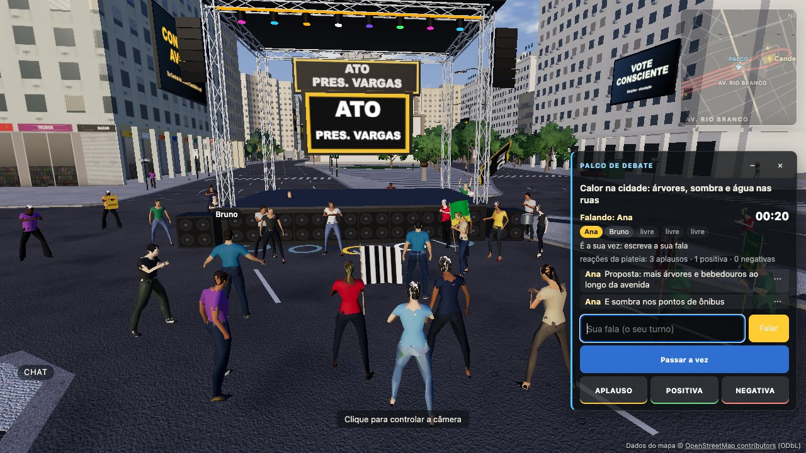

# Palco de debate em texto (rodada 9)

Um palco aberto no mundo: quem está perto **assiste**, quem quer falar **entra na fila**, o servidor dá o **turno**
(tempo dos dados), o orador escreve **falas de texto** e a plateia **reage** (aplauso / positiva / negativa). As
reações são contadas por turno e mostradas como **"reações da plateia"** — nunca como votação, enquete, placar ou "quem
ganhou". Temas são textos neutros dos dados; nada no código conhece grupo, partido, clube ou pessoa.



## Módulos

| Arquivo | O quê |
|---|---|
| `src/events/schedule.ts` | contrato (DebateSpec, `dbt`, DebateReaction, `dbt_queue`/`dbt_say`/`dbt_react`) |
| `src/events/debate.ts` | regras puras (cliente + servidor): `DEBATE_RULES`, `debateSeats`, `reactionSummary`, `clock`, extensões aditivas do `dbt` (`DebateStateWire`, `DebateMe`, `DebateLine`) |
| `server/src/debate/DebateRunner.ts` | runner do formato `debate` (sem Colyseus): fila, turnos, falas, reações, plateia, denúncias |
| `server/src/debate/DebateHost.ts` | adaptador fino: definições (agenda do evento ou `public/gameplay/debates.json`), janela da recorrência, `start/end/tick` |
| `server/src/chat/ChatService.ts` | `screen()` (pipeline de texto do chat reutilizado), `keyOf()`/`mutes()`/`onMute()` (mute por identidade) |
| `server/src/PresidenteVargasRoom.ts` | bloco `// rodada 9 — debate e telões`: ganchos e `dbt_*` |
| `src/ui/DebatePanel.ts`, `src/ui/agenda.css` | painel (HUD `mountOverlay`) |
| `src/events/DebateStage.ts` | marcas dos lugares na frente do palco + plateia NPC reagindo |
| `public/gameplay/debates.json` | dados: palco, turno, lugares, reações por minuto, temas |
| `tests/debateRunner.test.ts`, `tests/debateServer.test.ts`, `tools/qa/debate_mp.mjs` | testes (runner, sala real com clientes forjados, 3 navegadores) |

## Runner (forma dos runners de evento)

`new DebateRunner(def, spot, hooks, { store, eventId })` — `start(inst)`, `tick(now)`, `end(now, nextAt)`,
`onJoin(sid)`, `onLeave(sid)`, `state()`; mensagens `watch`, `queueReq`, `say`, `react`, `report`; `muted()` (aviso do
chat). Ganchos (`DebateHooks`): `send`, `who` (identidade ATUAL — a releitura do banco pode suspender no meio do
turno), `pos`, `near` (grade da sala + espectadores pela câmera), `screen` (= `ChatService.screen`), `keyOf`, `mutes`,
`emit` (barramento de gameplay), `gesture` (ação social existente).

Agendador: o `EventScheduler` (outro agente) chama o runner diretamente. Até ele chegar a esta árvore, o
`DebateHost` faz o mínimo: instância = `id@início` pela recorrência (`everyMin`, `offsetMin`, `durationMin`) no relógio
do servidor; fora da janela o estado diz `active:false` e `nextAt`. `DebateHost.agenda()` gera os itens de agenda do
debate (usados pelos telões).

## Dados (`public/gameplay/debates.json`)

```json
{ "id": "debate_palco", "format": "debate", "zones": ["RIO_BRANCO"],
  "recurrence": { "everyMin": 20, "offsetMin": 0, "registrationMin": 0, "startingS": 0, "durationMin": 18 },
  "capacity": 20, "debate": { "stageSpot": "stage0", "turnSeconds": 75, "turns": 6, "seats": 5, "reactionsPerMin": 12, "topics": ["…"] } }
```

Se o evento atual tiver itens `format: "debate"` em `agenda`, eles valem no lugar do arquivo. `validDebate` recusa
dados absurdos (turno < 5 s ou > 600 s, sem temas, > 12 lugares). Teste/QA: `PV_TEST=1 PV_DEBATE_FILE=…`
(`tests/fixtures/debate_teste.json`, turno de 8 s; `debate_qa.json`, 24 s). Nada de tempo fixo no código.

## Regras (servidor)

| Mensagem | Regra |
|---|---|
| `dbt_queue {inst, on}` | capacidade `debate.speak` (PLAYER no mundo — espectador, visitante, REGISTERED sem licença, **suspenso e banido não**); debate ativo; a ≤ 55 m do palco; fila ≤ 24 (e ≤ `capacity`). Ordem = chegada. `on:false` sai da fila; o **orador** com `on:false` passa a vez |
| `dbt_say {inst, text}` | `debate.speak` + **ser o orador do turno** (senão `nao_e_sua_vez`) + o **mesmo pipeline do chat** (`ChatService.screen`: cooldown vigente → caracteres inválidos → `textModeration.check(texto, 'chat')` → `floodCheck`; texto bloqueado gera o cooldown adaptativo). Anti-flood **compartilhado** com o chat (mesmo autor = mesmo estado) |
| `dbt_react {inst, r}` | `debate.react` (PLAYER, também assistindo como espectador); há orador; quem reage está na **plateia**; `reactionsPerMin` (dados) por autor (conta/conexão) em janela de 60 s → `limite` |
| `dbt_watch {on}` | abrir o painel de longe (agenda/menu): entra na plateia sem estar perto (teto 300) |
| `dbt_report {id, category, details?}` | `report.create`; a fala precisa ter sido recebida por quem denuncia, ≤ 15 min; não a própria; 1 por pessoa por fala; 6 por 10 min por denunciante |

Turno: quando não há orador e a fila tem gente (depois de uma pausa de 2,5 s), o primeiro sobe e ganha `turnSeconds`
(dados). Acaba no tempo, quando passa a vez, quando sai ou quando perde a permissão (releitura do banco a 1 Hz). Depois
de `turns` turnos, o tema seguinte (o debate continua enquanto a instância estiver ativa). Lugares: `[orador, próximos
da fila…]` com `seats` posições; no mundo são marcas no chão à frente do palco (`debateSeats`, mesma conta no cliente e no
servidor; sem física nova, ninguém é teleportado).

Plateia = quem está a ≤ 70 m do palco (jogadores pela grade espacial; espectadores pela câmera), recalculada a 1 Hz,
∪ quem abriu o painel ∪ fila/orador. **Estado `dbt` só para a plateia** (nunca global): na mudança, no máximo a 2 Hz.
Quem entra recebe o estado, as últimas 8 falas (sem as dos mutados) e `dbt_me`. Quem sai recebe `dbt_bye`.

Gameplay (`this.gameplay`): `debate_watch {seconds: 30}` em lotes para quem assiste com alguém falando;
`debate_turn` para o orador que concluiu um turno com ao menos uma fala; `debate_react` por reação aceita.

## Mensagens

| Direção | Tipo | Conteúdo |
|---|---|---|
| S → plateia | `dbt` | `DebateStateMessage` + `{ active, nextAt, seats, turn, turns, turnSeconds, nid }` (apelidos, nunca ids de conta) |
| S → conexão | `dbt_me` | `{ inst, pos, speaking, canSpeak, canReact, why? }` — só a quem mudou (o estado comum é igual para todos) |
| S → plateia | `dbt_line` | `{ id, inst, nick, nid, text, t, turn }` — menos quem mutou o autor |
| S → conexão | `dbt_hide` | `{ ids }` — mutou o autor agora: as falas dele já recebidas somem |
| S → conexão | `dbt_denied` | `{ kind: 'queue'\|'say'\|'react'\|'watch', reason, retryMs }` |
| S → conexão | `dbt_report_res` | `{ ok, id, r? }` |
| S → conexão | `dbt_bye` | saiu da plateia |

## Mute, denúncia, sanções

- **Mute por identidade** é o do chat (`chat_mute {nid}` pelo menu da fala; ou pela mensagem/lista do chat): o runner
  consulta `ChatService.mutes(viewer, authorKey)` e não envia a fala a quem mutou; `ChatService.onMute` avisa o runner,
  que manda `dbt_hide` das falas já recebidas.
- **Denúncia**: `Report` com `targetType: 'DEBATE_LINE'` (enum novo, migração `20261017140000_report_debate_line`),
  `targetRef: debate:<inst>:<id>`, evidência = cópia do servidor (texto, hora, tema, turno, apelido e userId do autor,
  nº de destinatários, até 3 falas anteriores do mesmo autor na instância). Anel de 15 min / 600 falas.
- **Sanções**: `SUSPENDED`/`BANNED` não têm `debate.speak` (política central); a releitura periódica das identidades
  atualiza `who()` e o runner tira o orador suspenso no próximo segundo.

## Cliente

- Painel (`DebatePanel`): abre sozinho ao entrar na plateia (primeiro `dbt`); fecha no ×, ou com `dbt_bye` (se não foi
  aberto pela agenda). Tema, "Falando: …", contagem regressiva (intervalo de 1 s só aberto e com orador), lugares,
  posição na fila, campo de texto **só no seu turno**, botões APLAUSO/POSITIVA/NEGATIVA (44 px), "reações da plateia",
  últimas 8 falas com "⋯" → denunciar (4 categorias) / silenciar. Digitando: teclas não chegam ao jogo. Celular: folha
  no alto, abaixo do minimapa (não cobre joystick nem botões). Recolhível (–).
- Gesto: a reação aceita faz o personagem tocar uma ação existente (aplauso → `clap`, positiva → `thumbs_up`,
  negativa → `talk`), pela MESMA validação das ações sociais (`onAct`).
- Plateia NPC: quando a contagem sobe, `DebateStage` pede ao `RallyCrowd` do ponto `stage_<palco>` que uma fração
  determinística (semente = instância + turno + total — todos os clientes veem o mesmo grupo) bata palmas / comemore
  por ~3 s (negativas: poucos, discretos). Local, sem rede.

## Testes e QA

- `tests/debateRunner.test.ts` (13): ordem da fila, turno pelos dados, passar a vez, só o orador fala, moderação
  reutilizada (spy em `textModeration.check` + cooldown compartilhado com o chat), mute + `dbt_hide`, sanções, limite e
  agregação das reações, sem palavra de "vencedor/votação", gameplay, denúncia DEBATE_LINE, dados/janela/lugares.
- `tests/debateServer.test.ts`: sala real, contas reais, clientes forjados (dbt_say fora da vez, campos extras, rajada
  de 30 reações → 5, longe não assiste), turno avança, denúncia.
- `node tools/qa/debate_mp.mjs http://localhost:5305` — 3 navegadores; servidor PV_TEST próprio na 3002: **25/25**.

## Limitações

- Sem agendador nesta árvore: a recorrência mínima vive no `DebateHost`; inscrição/`evt_join` é do agendador.
- Um palco (`stage0`) por definição; vários debates simultâneos = várias definições com palcos diferentes.
- Falas não são persistidas (só a evidência denunciada); quem chega vê as últimas 8.
