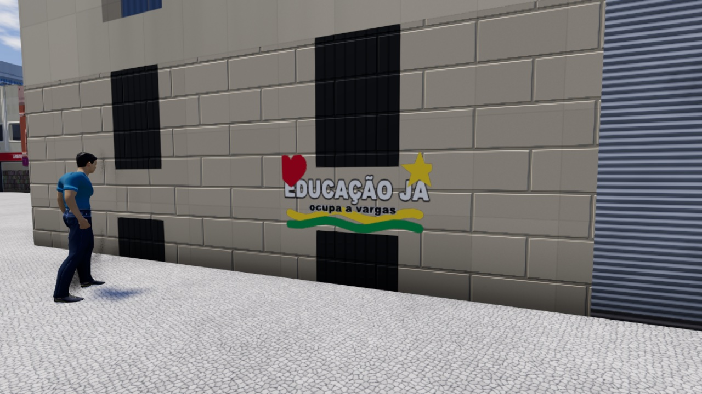

# Pichação / grafite (rodada 7)

Jogadores pintam **só em superfícies autorizadas** (nunca em malha arbitrária). O desenho é vetor compacto, validado
pelo servidor, distribuído por área de interesse, moderável e persistido. Captura: `docs/screenshots/round7/J_grafite_parede.jpg`.



## Módulos

| Arquivo | O quê |
|---|---|
| `src/graffiti/surfaces.ts` | `GraffitiSurface` (plano: origem, eixos u/v, tamanho, tipo, persistência, máximo, TTL), geometria pura (distância, lado, retângulo) |
| `src/graffiti/codec.ts` | conteúdo vetorial binário v1 (encode/decode, simplificação de traço), paleta, espessuras, símbolos |
| `src/graffiti/textFilter.ts` | saneamento + filtro básico PT-BR (palavrões/ódio/spam) do texto curto |
| `src/graffiti/rules.ts` | regras puras: limites, validação de conteúdo e alcance, cota/cooldown, **máquina de moderação**, TTL |
| `src/graffiti/protocol.ts` | mensagens `gf_*` (tipos) |
| `server/src/graffiti/GraffitiService.ts` | autoridade, interesse por superfície, moderação, expiração, API de admin (sem Colyseus: testável) |
| `server/src/graffiti/store.ts` | `GraffitiStore` (interface) + `JsonFileGraffitiStore` (dev) + `MemoryGraffitiStore` (testes) |
| `src/graffiti/GraffitiSystem.ts` | cliente: superfícies, tapumes, prompt, rede, denúncia/ocultação, depuração |
| `src/graffiti/GraffitiEditor.ts` + `graffiti.css` | modo de desenho (DOM, mouse e toque) |
| `src/graffiti/GraffitiRenderer.ts` + `raster.ts` | decalques num atlas compartilhado; rasterização do vetor |
| `tools/build_graffiti_surfaces.ts` | gera `public/world/graffiti_surfaces.json` (`npm run map:graffiti`, também no fim de `npm run map`) |

Ganchos fora destes módulos (pequenos e delimitados): `Game.ts` (criar/carregar, `E` sem veículo perto → `tryOpen`,
prompt, parado enquanto desenha, `update`, `__pv.graffiti()`/`__pv.gf`), `NetworkClient.on()` + `cid` no join,
`JoinOptions.cid` (`src/net/protocol.ts`), `src/net/clientId.ts`, sala (`gf_new`/`gf_report`/`gf_admin`, `join`/`leave`,
`update` no tick, `flush` no `onDispose`) e `server/src/world.ts` (carrega superfícies e a colisão dos tapumes).

## Superfícies autorizadas (dados)

`public/world/graffiti_surfaces.json` — o MESMO arquivo no cliente e no servidor. Gerado do mundo já construído:

| Tipo | Persistência | Origem | Hoje |
|---|---|---|---|
| `wall` | temporária (manifestação, TTL) | fachadas no nível da rua voltadas para a Pres. Vargas: sem galeria/arcada, sem modelo dedicado, com ≥ 2,4 m de calçada livre, espaçadas ≥ 14 m; 2,5 m de altura a partir de 0,3 m | 64 |
| `mural` | **permanente** (autorizado; só moderação remove) | 3 fachadas perto do spawn | 3 |
| `tapume` | temporária | 6 painéis de obra (6,4 × 2,3 m) diante de fachadas largas — renderizados pelo cliente, **com colisão nos dois lados** (mesmos sólidos no servidor) | 6 |
| `ground` | temporária | áreas de 4 × 4 m inteiras dentro de praças perto do eixo | 3 |

Plano: `o` (canto inferior-esquerdo), `u` (largura), `v` (altura; no chão aponta para o norte) e `w × h` em metros; o lado
pintável é a normal `u × v`. Cada superfície tem `max` (grafites simultâneos) e, opcional, `ttlMs` (0 = permanente).

## Interação

- Perto (≤ 2,4 m no cliente; o servidor aceita ≤ 3 m) e **de frente** para uma superfície, sem veículo perto:
  prompt **"E — PICHAR A PAREDE / O TAPUME / O MURAL / O CHÃO"** (toque: botão **USAR**). Veículo perto tem prioridade.
- Editor (DOM, `pointer events`, funciona com mouse e dedo): traço livre, 12 cores, 3 espessuras, 6 símbolos
  (coração, estrela, seta, paz, círculo, sol), texto ≤ 24 caracteres (até 2), tamanho P/M/G (1,0 / 1,6 / 2,2 m, sempre 2:1),
  desfazer/limpar, medidor de bytes. Fecha com **Esc** ou **✕**. Enquanto aberto o jogador fica parado e o teclado não
  chega ao jogo. **Nada é enviado durante o desenho.**
- "PICHAR": o cliente valida com as mesmas regras e manda **uma** mensagem `gf_new`; o editor fica em "Enviando…" e fecha
  no `gf_res` ok (na recusa mostra o motivo e mantém o desenho para corrigir).
- Perto de um grafite de outra pessoa: painel **"Grafite de X · Ocultar p/ mim · Denunciar"**.
- Sem servidor (single-player) o grafite fica só local.

## Formato e bytes

Conteúdo v1 (little-endian), espaço do desenho 256 × 128 (u8):

| Parte | Bytes |
|---|---|
| cabeçalho: versão, retângulo `s, t, w, h` (u16 cm), nº de itens | 10 |
| traço: tipo, cor<<4 \| espessura, n, n × (x, y) | 3 + 2n |
| símbolo: tipo, cor, símbolo, x, y, tamanho, rotação | 7 |
| texto (**caminho moderável**): tipo, cor, x, y, tamanho, len, UTF-8 | 6 + len |

Traços passam por Douglas-Peucker (tolerância 1,2 unidade) no editor. Medidos:

| Caso | Conteúdo | `gf_new` | `gf_add` (por cliente) |
|---|---|---|---|
| QA multiplayer (1 traço, 2 símbolos, texto "Ocupa a Vargas") | 81 B | ≈ 106 B | ≈ 137 B |
| captura da fachada (2 traços, 2 símbolos, 2 textos) | 112 B | ≈ 137 B | ≈ 168 B |
| rabisco "pesado" (12 traços × 12 pontos + texto) | 350 B | ≈ 375 B | ≈ 406 B |
| limite aceito | 4096 B, 64 itens, 1500 pontos, 2 textos | | |

## Mensagens

| Direção | Mensagem | Conteúdo |
|---|---|---|
| C → S | `gf_new` | `{ s: superfície, d: Uint8Array, n: nonce }` |
| C → S | `gf_report` | `{ i: id }` |
| C → S | `gf_admin` | `{ token, op: 'list'\|'remove'\|'hide'\|'restore', i? }` — **só com `PV_ADMIN_TOKEN`** (dev) |
| S → C | `gf_add` | `GfWire[]`: `{ i, s, d, a: nome do autor, t: criado, e: expira (0 = permanente), st, m?: 1 se é seu }` |
| S → C | `gf_del` | `{ i: id[], r: 'aoi'\|'hidden'\|'removed'\|'expired'\|'evicted' }` |
| S → C | `gf_state` | `{ i, st }` (ACTIVE ↔ REPORTED, ainda visível) |
| S → C | `gf_res` | `{ op: 'new'\|'report'\|'admin', ok, n?, i?, r?: motivo, list? }` |

O id anônimo do autor **nunca** sai do servidor (só o nome de exibição).

## Regras do servidor (autoridade)

Ao receber `gf_new`, em ordem: jogador de pé e fora de veículo · superfície existe · conteúdo decodifica sem sobra,
≤ 4096 B, ≤ 64 itens, ≤ 1500 pontos, cores/espessuras/símbolos válidos, retângulo **dentro** da superfície, 0,3–2,4 m,
proporção 2:1 · texto saneado e aprovado pelo filtro · autor a **≤ 3 m** da área pintada e **do lado pintável** (posição
autoritativa do servidor) · cooldown (20 s) e cota (6 ativos, 12 por hora) **por sessão E por id anônimo** (reconectar não
zera; trocar o id não zera a sessão) · máximo por superfície (temporária: sai o mais antigo dela — "repintar";
autorizada: recusa `superficie_cheia`) · total no mundo (2000: sai o temporário mais antigo; permanentes nunca).
Só então ganha id único e é gravado `{ id, autor: { sessionId, nome, clientId }, superfície, retângulo, conteúdo,
createdAt, expiresAt, estado, denúncias, persistência, hasText }`.

Motivos de recusa (`gf_res.r`): `superficie`, `distancia`, `lado`, `formato`, `tamanho`, `retangulo`, `itens`,
`texto`, `texto_bloqueado`, `cooldown`, `cota`, `cota_hora`, `superficie_cheia`, `mundo_cheio`, `estado`.

## Interesse (quem recebe o quê)

- Grade espacial **estática** das superfícies (`SpatialGrid`, a mesma da AOI de jogadores). Cada cliente tem o conjunto
  de superfícies a ≤ `PV_GRAFFITI_AOI` (120 m, + raio da superfície; sai só além de × 1,15) e o conjunto de grafites que já
  tem. Atualização **fatiada** no tick (cada cliente a 2 Hz) com a posição autoritativa.
- Superfície entra na área → os grafites visíveis dela entram numa fila, enviada em lotes `gf_add` com orçamento de
  24 KB por atualização (sem pico ao entrar numa área cheia). Saiu → `gf_del { r: 'aoi' }` e o cliente descarta.
- Criação: vai na hora para o autor e para quem tem a superfície na área. Ninguém recebe desenho parcial ou inválido.
- **Entrar na sala** já roda a atualização do novo cliente: quem entra depois recebe os grafites próximos existentes.
- Ocultação/remoção/expiração: `gf_del` só para quem tinha. HIDDEN/REMOVED/EXPIRED nunca são enviados.

## Moderação

Estados: `ACTIVE (0)`, `REPORTED (1)`, `HIDDEN (2)`, `REMOVED (3)`, `EXPIRED (4)` — `moderate()` em `src/graffiti/rules.ts`:

```
ACTIVE ─denúncia→ REPORTED ─(N denunciantes DISTINTOS, PV_GRAFFITI_REPORTS = 3)→ HIDDEN
ACTIVE/REPORTED/HIDDEN ─TTL→ EXPIRED            (só temporários)
qualquer não-terminal ─admin remove→ REMOVED · ─admin hide→ HIDDEN · HIDDEN/REPORTED ─admin restore→ ACTIVE
REMOVED e EXPIRED são terminais (saem da memória e do armazenamento)
```

- Denúncia: qualquer jogador que **tem** o grafite (está na área); não vale denunciar o próprio; o mesmo id anônimo conta
  uma vez; ≤ 10 denúncias/min. Quem denuncia passa a não ver aquele grafite.
- Ocultar para mim: lista por cliente em `localStorage['pv.graffiti.hidden']` (últimos 500 ids).
- Texto: filtro de primeira linha (acentos, leetspeak e letras repetidas normalizados; palavras inteiras, raízes e
  texto sem espaços; links/telefones). Desenho livre não tem filtro automático — por isso existem denúncia e admin.
- Admin (sem painel): `GraffitiService.adminAction('remove'|'hide'|'restore', id)` e `adminList()` no servidor; mensagem
  de desenvolvimento `gf_admin` exige `PV_ADMIN_TOKEN` (sem a variável fica desativada; token comparado em tempo
  constante; tentativas inválidas vão para o log). Cada ação registra autor (nome, id anônimo, sessão) no log.

## Identidade (provisória)

Não há login. Autor = **sessionId + nome + id anônimo estável** (UUID em `localStorage['pv.clientId']`, enviado no join
como `cid`; inválido → `anon-<sessionId>`). Limpar o navegador gera outro id: é um limite de abuso, não identidade.
Com login, a conta substitui o `clientId` nos mesmos campos (`author.clientId`) e nas chaves de cota.

## Persistência

`GraffitiStore` (`load` assíncrono, `put`, `delete`, `flush`). Em dev: `JsonFileGraffitiStore` em
`server/data/graffiti.json` (fora do git; `PV_GRAFFITI_FILE` muda o caminho; `PV_GRAFFITI_STORE=memory` não grava).
Carrega na criação da sala, grava **debounced** (2 s, `PV_GRAFFITI_SAVE_MS`) e **atômico** (temporário + rename), e
grava já no `onDispose`. Na carga descarta terminais e grafites de superfícies que deixaram de existir; arquivo ilegível vira
`.bad` (o servidor sobe vazio). Trocar por banco = outra implementação da interface.

Temporários: TTL padrão **6 h** (`PV_GRAFFITI_TTL_MS`; a superfície pode ter `ttlMs` próprio). Autorizados (`mural`):
sem prazo. Expiração checada a 1 Hz.

Variáveis: `PV_GRAFFITI_TTL_MS`, `PV_GRAFFITI_REPORTS`, `PV_GRAFFITI_COOLDOWN_MS`, `PV_GRAFFITI_MAX_ACTIVE`,
`PV_GRAFFITI_MAX_HOUR`, `PV_GRAFFITI_MAX_TOTAL`, `PV_GRAFFITI_AOI`, `PV_GRAFFITI_FILE`, `PV_GRAFFITI_STORE`,
`PV_GRAFFITI_SAVE_MS`, `PV_ADMIN_TOKEN`.

## Desenho e memória

- **Decalques num atlas**, nunca uma textura grande por grafite: páginas 1024² (CanvasTexture com mipmaps) com 32 tiles
  de 256 × 128; o vetor é rasterizado uma vez no tile (2 px de margem contra "sangria" dos mipmaps). Um quad por grafite
  no plano da superfície (2 cm à frente + `polygonOffset`), num `InstancedMesh` por página → **1 draw call por página**.
- Orçamento por preset: alto 96 tiles a ≤ 90 m (3 páginas), médio 64 a ≤ 80 m, baixo 32 a ≤ 60 m (1 página). Fora do
  orçamento/distância o grafite fica só como vetor (bytes) e ganha tile ao chegar perto; no máximo 4 rasterizações por
  quadro (sem travada quando chegam muitos).
- Medido (`tools/qa/graffiti_memory.mjs`, preset alto, Mac M-series):

| | por grafite | por 100 (pior caso, todos com tile) |
|---|---|---|
| GPU | 171 KB (tile 256×128 RGBA + mips, rateio da página de 5,6 MB) | 22,4 MB (4 páginas) — com o orçamento padrão: ≤ 16,8 MB |
| heap JS (cliente) | ≈ 6 KB (conteúdo decodificado + registro) | ≈ 1 MB |
| rede/armazenamento | conteúdo 80–400 B típico (≤ 4 KB) | ~35 KB de `gf_add` típicos |
| draw calls | — | +4 (uma por página) |
| CPU do quadro | — | sem mudança mensurável (3,6 → 3,7 ms) |

## Testes

- Unitários: `tests/graffiti.test.ts` (codec ida/volta e bytes, lixo/truncado, simplificação, superfícies, filtro de
  texto, validação, alcance, cota/cooldown, TTL, máquina de moderação) e `tests/graffitiService.test.ts` (distribuição
  A/B/C/D, nada inválido vaza, cota por sessão e por id, máximo por superfície e total, AOI, denúncia → oculto →
  restaurar, admin com token, TTL, persistência JSON com recarga).
- Multiplayer real: `node tools/qa/graffiti_mp.mjs http://localhost:5173` (servidor de teste próprio na porta 2674,
  4 navegadores) — **26/26**: B não recebe nada durante o desenho de A; B vê após publicar; C distante não recebe;
  cliente modificado (lixo, superfície falsa, longe) recusado sem vazar nada; D que entra depois recebe; denúncia →
  REPORTED → 2 denúncias → oculto para todos; autor não denuncia o próprio; ocultar localmente; persistência JSON;
  admin com token; TTL curto expira para todos e sai do arquivo.
- Capturas: `node tools/qa/graffiti_shot.mjs [url] [superfície] [qualidade]` → `screenshots/round7/graffiti/`.

## Limitações

- Identidade é anônima por aparelho (sem login): quem limpa o navegador e reconecta ganha cota nova (cooldown da sessão
  continua valendo só enquanto a sessão existe).
- Filtro de texto é básico (lista curta); desenho livre depende de denúncia/admin. Não há painel de moderação.
- Grafites sobrepostos na mesma superfície não se recortam e a ordem entre eles não é garantida (a reciclagem do mais
  antigo e o máximo por superfície limitam o caso).
- Superfícies são retângulos planos: fachadas com galeria/arcada e prédios com modelo dedicado ficam de fora.
- Rasterização do texto usa as fontes do sistema (Arial Black/Impact): a aparência varia levemente entre aparelhos.
