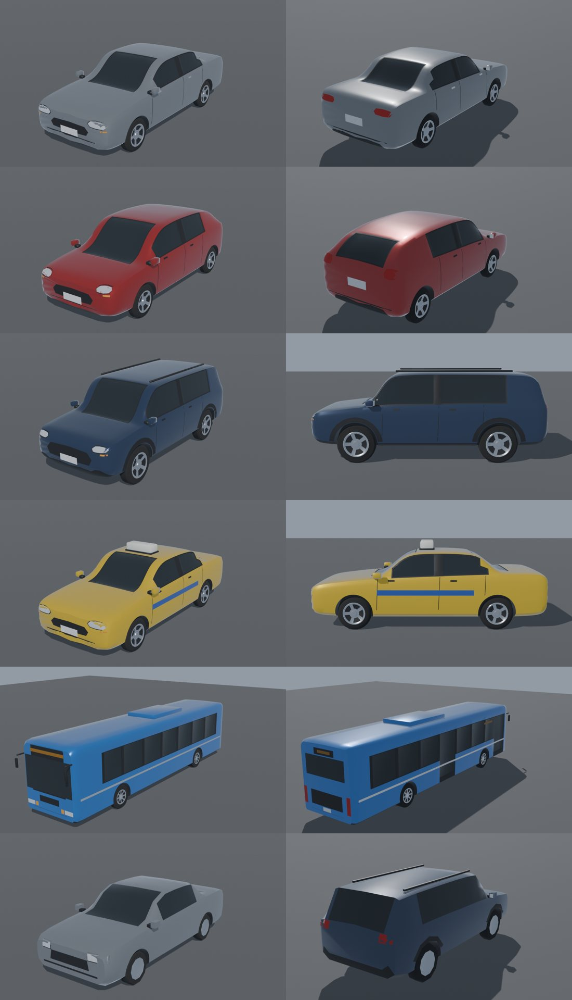

# Veículos do trânsito — pipeline visual (Rodada 5)

Substitui os carros/ônibus de caixas por veículos genéricos semi-realistas: **sedan, hatch, SUV, táxi
carioca (amarelo + faixa azul + luminoso) e ônibus urbano**, cada um com **LOD0** (perto) e **LOD1** (> 60 m).
Tudo é procedural e original (ver `docs/licenses/vehicles.md`).

## Pipeline

1. **Modelagem** — `tools/vehicles/build_vehicles.py` (Blender 5.2 headless):
   - carroceria por *loft* de seções transversais (9 pontos por meia-seção: assoalho, soleira, porta, ombro,
     linha de cintura, vidro, borda do teto, teto) ao longo do comprimento, com perfis lateral/planta
     interpolados por cúbica monotônica (sem overshoot);
   - Subdivision Surface (nível 1 no LOD0) com *creases* no ombro, cintura, borda do teto e soleira;
   - materiais atribuídos por região (vidros laterais com bordas inclinadas paralelas às colunas, para-brisa,
     vigia, coluna B preta), vidros com moldura de borracha (*inset*) e levemente rebaixados;
   - caixas de roda por booleana (cilindros) — a parede interna herda o plástico preto;
   - faróis (com carcaça escura), lanternas, piscas, grade, entrada de ar, placas sem caracteres, frisos de
     porta e maçanetas **projetados** sobre a lataria (shrinkwrap);
   - rodas torneadas: pneu com ombro arredondado (borracha) + aro de liga côncavo com 5 raios sugeridos,
     lábio cromado e cubo; ônibus com rodado duplo traseiro;
   - SUV: molduras plásticas nas caixas de roda e longarinas no teto; táxi: faixa azul lateral + luminoso;
     ônibus: faixa de janelas preta, portas à direita, letreiros LED de destino, retrovisores "orelha", AC no teto.
2. **Exportação** — um único GLB com nós `<modelo>_LOD0/1`, materiais por nome
   (`paint, glass, trim, rubber, alloy, chrome, lamp_front, lamp_rear, lamp_amber, stripe, plate, sign, sign_taxi`);
   frente em +Z, direita em −X (convenção do `TrafficSystem`).
3. **Compressão** — `gltf-transform meshopt` (quantização + EXT_meshopt_compression).
   Comando completo: `sh tools/vehicles/build.sh` (render de conferência: `sh tools/vehicles/build.sh --render <pasta>`).
4. **Cliente** — `src/traffic/vehicleModels.ts` carrega o GLB uma vez (`loadVehicleModels()` no `Game.load`,
   antes do `TrafficSystem`), e "assa" cada material em atributos por vértice (`color` + `aPbr` =
   rugosidade, metalicidade, máscara de pintura, classe de emissão). Um único `MeshPhysicalMaterial`
   (verniz/clearcoat apenas na pintura) lê esses atributos via `onBeforeCompile`; a cor da pintura vem do
   `instanceColor`. Resultado: **1 InstancedMesh por modelo/LOD = 10 draw calls** para todo o trânsito
   (antes: 13 com caixas). Sem o GLB (testes/falha de rede) os modelos de caixas antigos são usados como reserva.
5. **TrafficSystem** — por quadro: culling por veículo na CPU (esfera ampliada contra o frustum), escolha do
   LOD por distância (60 m), instâncias compactadas (`count` = visíveis; antes, todas as vagas eram enviadas
   com escala 0). `'car'` da simulação vira sedan/hatch/SUV de forma determinística pelo id (`carModelFor`),
   então todos os clientes concordam. Semântica da simulação, snapshot de rede e servidor **inalterados**.
6. **Luzes** — `setVehicleNight(night)`: faróis (leve DRL de dia, fortes à noite), lanternas sempre um pouco
   acesas, letreiro do ônibus sempre aceso, luminoso do táxi à noite.
7. **Carro dirigível** (`Rideable`) usa o mesmo sedan (4,44 m × 1,78 m de carroceria; caixa de colisão
   2,2 × 0,9 m de meia-dimensão em `rules.ts` mantida).

## Orçamentos e medidas

| Modelo | LOD0 (tris) | LOD1 (tris) | dimensões (C × L × A, m) |
|---|---|---|---|
| sedan | 8.864 | 1.744 | 4,44 × 1,78 (1,96 c/ retrovisores) × 1,45 |
| hatch | 8.580 | 1.652 | 4,00 × 1,74 × 1,47 |
| SUV | 9.364 | 1.762 | 4,47 × 1,82 × 1,72 |
| táxi | 9.080 | 1.780 | 4,44 × 1,78 × 1,63 (luminoso) |
| ônibus | 5.246 | 2.174 | 12,2 (+retrovisores) × 2,55 × 3,28 |

Download: **`vehicles.glb` = 424 KB** (≈ 210 KB com gzip/brotli do servidor), sem texturas. Bruto do Blender: 1,23 MB.

Métricas (`tools/qa/fidelity_shots.mjs`, quality=high, 10:30, 1600×900; GPU compartilhada com outros
processos — `gpuMs` oscila ±3 ms entre execuções idênticas, por isso duas execuções de cada):

| Captura | Antes calls | Depois calls | Antes tris | Depois tris | Antes cpu/gpu ms | Depois cpu/gpu ms |
|---|---|---|---|---|---|---|
| D (avenida) | 941 / 942 | 922 / 912 | 1,583 M / 1,589 M | 1,552 M / 1,530 M | 3,35/6,34 · 2,68/7,17 | 2,49/5,09 · 3,28/8,31 |
| G (veículos) | 762 / 760 | 735 / 740 | 1,459 M / 1,450 M | 1,677 M / 1,697 M | 5,29/10,58 · 2,77/7,99 | 2,78/8,00 · 3,98/7,01 |

Leitura: −20 draw calls; +~15% de triângulos na captura G (vários veículos próximos em LOD0) e leve queda
na D (culling por veículo + instâncias compactadas compensam a geometria mais rica). CPU/GPU dentro do ruído.

Comparativos: `screenshots/vehicles/parked_before_after.jpg`, `shotG_before_after.jpg`,
`ingame_closeups.jpg`, `night_closeups.jpg`. Close-ups reproduzíveis: `node tools/qa/vehicle_closeup.mjs <pasta>`.

## Limitações conhecidas

- Vidros opacos (escuros e reflexivos), sem interior visível; rodas não giram (geometria instanciada única).
- Superfícies ainda "macias" demais em alguns ângulos (o loft + subdivisão arredonda vincos); sem detalhes
  de para-choque/lanterna modelados em relevo — são lentes/plásticos projetados.
- Ônibus: traseira simples (vidro + grade como painéis), sem letreiro com texto (só a faixa LED).
- LOD1 é a mesma topologia sem subdivisão (facetado de perto, intencional > 60 m).
